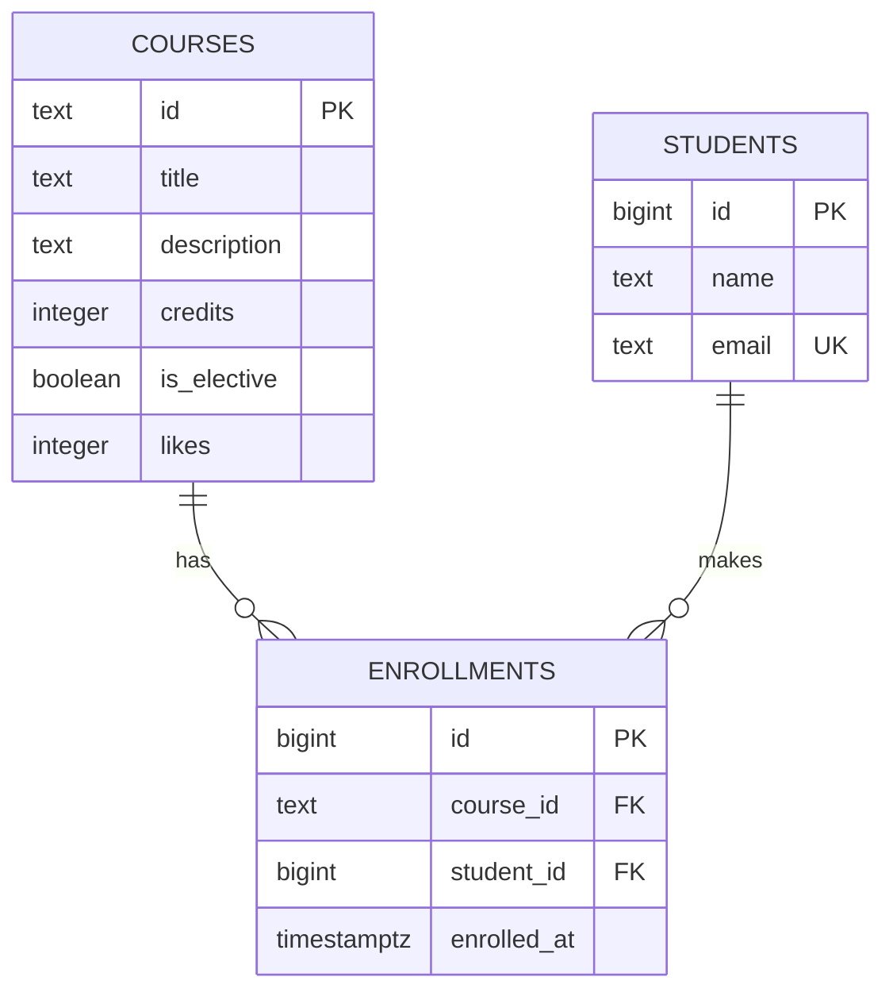

# Course Catalog Database — Lab 6

This repository implements the PostgreSQL schema behind the course catalog from Labs 4 and 5. It contains repeatable schema and seed scripts, the SQL used by the API routes, measured database experiments, and all five bonus tasks.

## How to run

Requirements: PostgreSQL 16 or newer and the `psql` client.

Create a database and load the lab in this order:

```bash
createdb course_catalog
psql -d course_catalog -v ON_ERROR_STOP=1 -f schema.sql
psql -d course_catalog -v ON_ERROR_STOP=1 -f seed.sql
psql -d course_catalog -v ON_ERROR_STOP=1 -f queries.sql
```

For a Docker-only setup:

```bash
docker run --name lab6-postgres \
  -e POSTGRES_PASSWORD=postgres \
  -p 5432:5432 -d postgres:16

docker exec lab6-postgres createdb -U postgres course_catalog
docker exec -i lab6-postgres psql -U postgres -d course_catalog < schema.sql
docker exec -i lab6-postgres psql -U postgres -d course_catalog < seed.sql
```

Run the automated verification against the connection configured by the `LAB6_DB_*` environment variables (defaults are documented in `tests/test_lab6.py`):

```bash
python3 -m unittest discover -s tests -v
```

`schema.sql` intentionally drops the three lab tables first, so rerunning it deletes their data. This is convenient for a reproducible lab; production applications should use versioned migrations instead.

## Schema



- `courses` uses the API's stable text slug as its primary key.
- `students` and `enrollments` use `GENERATED ALWAYS AS IDENTITY`; PostgreSQL owns their numeric identifiers.
- `enrollments` is the join table for the many-to-many relationship. Its `(course_id, student_id)` unique constraint prevents a student from enrolling twice in one course.
- Deleting a student cascades to that student's enrollments. Deleting a referenced course is restricted, which prevents accidental loss of enrollment history.
- `enrollments_student_id_idx` supports lookups from a student to their enrollments. PostgreSQL already creates indexes for primary keys and unique constraints, but not automatically for the referencing side of a foreign key.

## Design decisions

The schema keeps the data in third normal form: course facts live only in `courses`, student facts only in `students`, and the relationship only in `enrollments`. `NOT NULL` expresses mandatory data, `CHECK` constraints protect business invariants, `UNIQUE` protects natural uniqueness, and foreign keys protect relationships even when data is written outside the FastAPI application.

`timestamptz` is used for `enrolled_at` so the instant remains unambiguous across time zones. Defaults belong in the database for values every client should receive consistently: `is_elective = false`, `likes = 0`, `enrolled_at = now()`. The email-format check is deliberately modest; it rejects obvious non-addresses while full user-facing validation remains an application concern.

## Constraint violation log

The following results were reproduced on PostgreSQL 16.15 after loading `schema.sql` and `seed.sql`. SQLSTATE is the stable machine-readable field; messages are useful for humans but should not drive API logic.

| # | Deliberate violation | SQLSTATE | Constraint / column | Recommended API response |
|---:|---|---|---|---|
| 1 | Insert a course with `title = NULL` | `23502` | `courses.title` | `422 Unprocessable Entity` |
| 2 | Insert a course with `credits = 0` | `23514` | `courses_credits_check` | `422 Unprocessable Entity` |
| 3 | Set a course's `likes = -1` | `23514` | `courses_likes_check` | `500 Internal Server Error` because the server created an impossible state |
| 4 | Insert a one-character student name | `23514` | `students_name_check` | `422 Unprocessable Entity` |
| 5 | Reuse `aigerim@example.com` | `23505` | `students_email_key` | `409 Conflict` |
| 6 | Reuse course id `api-design` | `23505` | `courses_pkey` | `409 Conflict` |
| 7 | Repeat enrollment `(modern-frontend, 1)` | `23505` | `enrollments_course_id_student_id_key` | `409 Conflict` |
| 8 | Enroll in `no-such-course` | `23503` | `enrollments_course_id_fkey` | `404 Not Found` |
| 9 | Enroll missing student `9999` | `23503` | `enrollments_student_id_fkey` | `404 Not Found` |
| 10 | Delete referenced course `modern-frontend` | `23503` | `enrollments_course_id_fkey` | `409 Conflict` |

The delete behavior was also measured inside a transaction. There were 6 enrollments before deleting Daniyar (student 2), 3 immediately after the delete because his 3 rows cascaded, and 6 again after `ROLLBACK`.

Two additional checks confirm the bonus and identity rules:

- Supplying a manual value for a `GENERATED ALWAYS` student id produced SQLSTATE `428C9`; normally this is a server-side misuse and maps to `500`.
- Inserting `invalid-email` produced `23514` from `students_email_format`; user input maps to `422`.

### Why both Pydantic and database constraints?

Pydantic should reject invalid request bodies before SQL is sent, giving the caller a fast and precise `422`. Database constraints are still mandatory: other scripts or services can bypass FastAPI, application bugs can construct invalid SQL, and concurrent requests can both pass an application check before one violates uniqueness. The API should catch database exceptions, inspect SQLSTATE and the constraint name, roll back the transaction, and translate known conflicts into `404`, `409`, or `422` without exposing raw database errors.

## Index experiment

The experiment used an isolated `idx_demo` database and the deterministic generator in `experiments/idx_data.sql`: 500 courses, 20,000 students, and 50,000 enrollments. Because the final `schema.sql` already contains the required index, it was dropped only in `idx_demo` to reproduce the “before” state:

```sql
DROP INDEX enrollments_student_id_idx;
\i experiments/idx_data.sql

EXPLAIN (ANALYZE, BUFFERS)
SELECT * FROM enrollments WHERE student_id = 777;

CREATE INDEX enrollments_student_id_idx ON enrollments (student_id);
ANALYZE enrollments;

EXPLAIN (ANALYZE, BUFFERS)
SELECT * FROM enrollments WHERE student_id = 777;
```

Student 777 has 3 enrollment rows. Each state was measured three times on PostgreSQL 16.15.

| State | Access method | Estimated cost | Rows removed by filter | Execution times | Mean |
|---|---|---:|---:|---|---:|
| Before index | Sequential scan | `0.00..1042.00` | 49,997 | 1.692, 1.739, 1.794 ms | 1.742 ms |
| After index | Bitmap index + bitmap heap scan | `4.31..15.59` | 0 | 0.088, 0.064, 0.061 ms | 0.071 ms |

Representative plans:

```text
Seq Scan on enrollments  (cost=0.00..1042.00 rows=3 width=34)
  (actual time=0.032..1.674 rows=3 loops=1)
  Filter: (student_id = 777)
  Rows Removed by Filter: 49997
Execution Time: 1.692 ms
```

```text
Bitmap Heap Scan on enrollments  (cost=4.31..15.59 rows=3 width=34)
  (actual time=0.014..0.031 rows=3 loops=1)
  Recheck Cond: (student_id = 777)
  -> Bitmap Index Scan on enrollments_student_id_idx
       Index Cond: (student_id = 777)
Execution Time: 0.061 ms
```

The plan changed because `student_id = 777` is highly selective: only 3 of 50,000 rows match. Without the index PostgreSQL must inspect every row; with it, the engine finds the three tuple locations and reads only their heap blocks. The measured mean was about **24.5× faster** on this small local data set. This does not mean every query benefits from an index: a query returning most of the table may still be cheaper as a sequential scan, and each index costs storage plus extra work on inserts, updates, and deletes.

## Transaction experiment

### Failure rolls back the whole unit

In one transaction, the first statement inserted `temporary@example.com`; the second attempted the already-used `aigerim@example.com` and failed with `23505`. PostgreSQL marked the transaction as aborted, `COMMIT` resulted in `ROLLBACK`, and the final count for the temporary email was `0`. The first successful statement did not leak through:

```text
BEGIN
INSERT 0 1
ERROR: 23505: duplicate key value violates unique constraint "students_email_key"
ROLLBACK
temporary_rows_after_failure = 0
```

This is atomicity: a multi-statement operation either commits as one unit or leaves no partial result. An application must explicitly roll back after an error before it can reuse that transaction/session.

### Two-session visibility

Session A began a transaction, inserted `transaction@example.com` and its enrollment, then paused before committing. Session A could see its own writes (`1` student), but Session B saw `0|0` for the student and enrollment. After A committed, the same query in B returned `1|1`.

```text
                         Session A                    Session B
BEGIN
INSERT student
INSERT enrollment
sees student = 1
                         (before COMMIT)              sees 0 students, 0 enrollments
COMMIT
                         (after COMMIT)               sees 1 student, 1 enrollment
```

This matches PostgreSQL's default `READ COMMITTED` isolation: another transaction sees only data committed before each statement begins. The experiment database was reset with `schema.sql` and `seed.sql` afterward.

## Bonus tasks

The normalization, concurrency, injection, analytical-query, and schema-evolution results are documented after their experiments.

## Self-review checklist

- [x] Three normalized tables and all required constraints are defined.
- [x] Seed data contains exactly 6 courses, 3 students, and 6 enrollments.
- [x] Required API queries and both bonus reports are present.
- [x] Constraint failures were reproduced against PostgreSQL.
- [x] Before/after index plans and measured timings are documented.
- [x] Transaction failure and two-session visibility are documented.
- [ ] All five bonus tasks are documented.
- [ ] Fresh automated verification passes.
